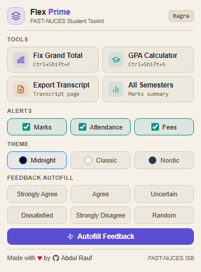
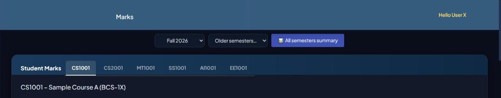
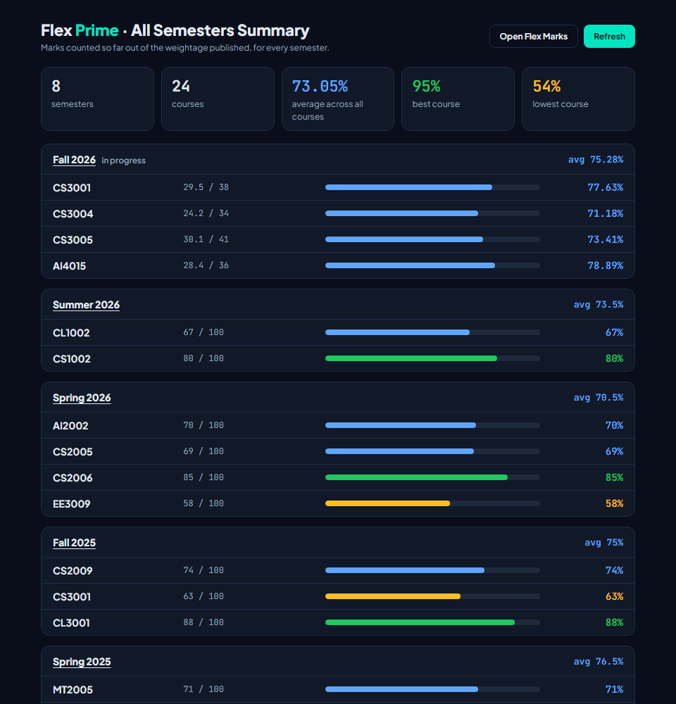
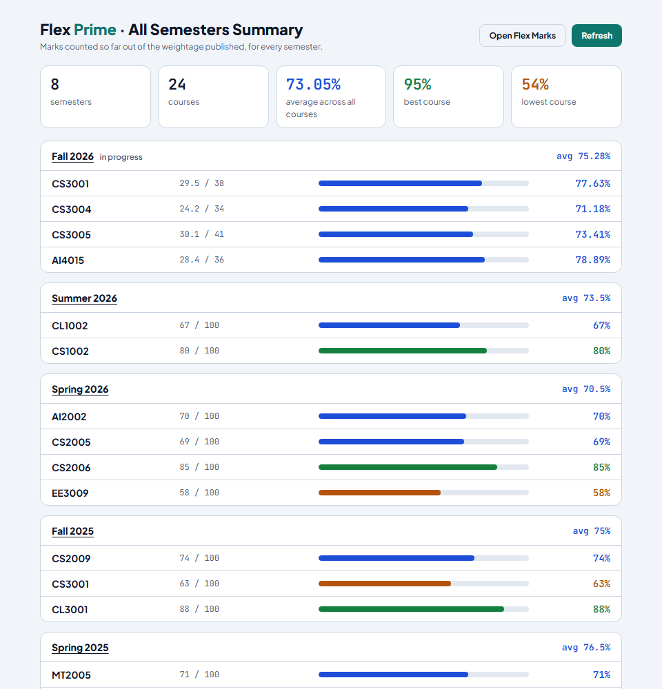
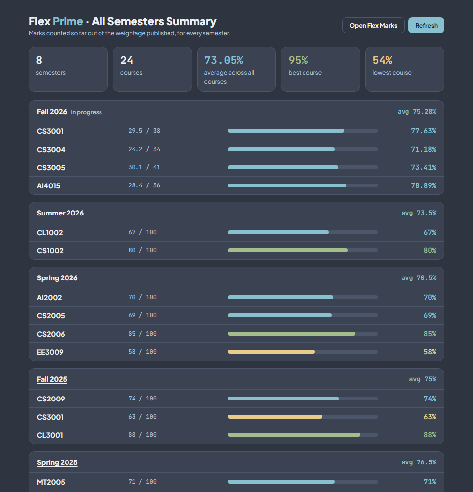
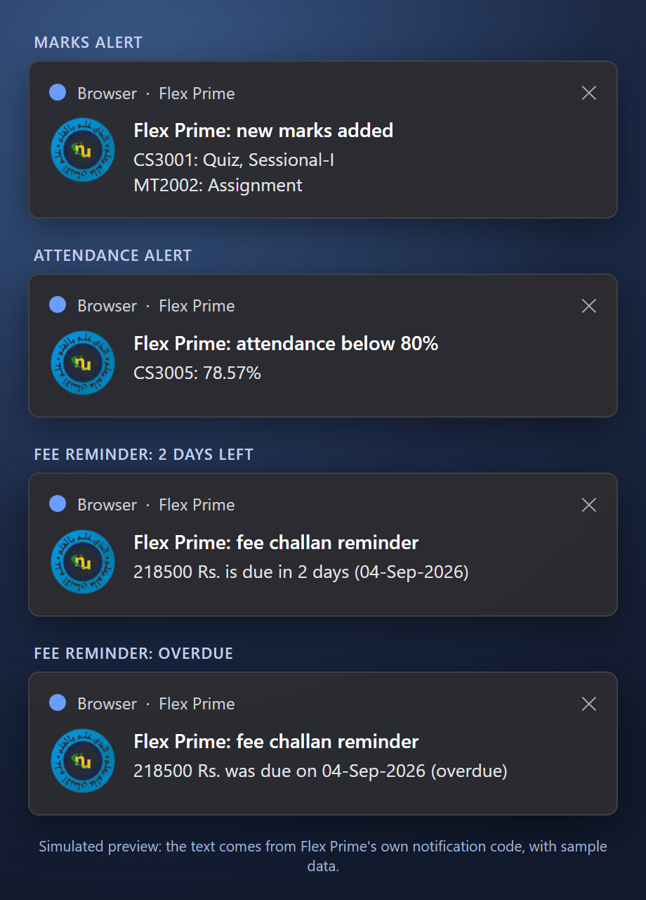
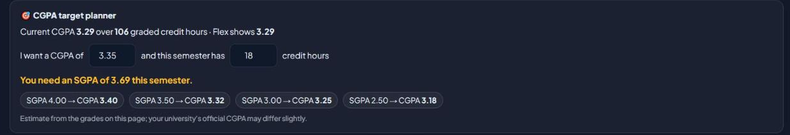

# ✨ Flex Prime: Supercharge Your FAST University LMS Experience ✨

Flex Prime is a browser extension built to make the FAST University FlexStudent portal actually pleasant to use. It fixes broken features, adds missing ones, warns you before things go wrong, and gives the whole interface a modern coat of paint, all without touching your login session.

  

> **Latest: version 2.5** (MIT licensed). Recent versions added a single-menu popup, older-semester marks, an all-semesters summary page, background alerts for marks, attendance and fees, a CGPA target planner, an update notifier and a "what's new" note after updates. See the [features](#-features) below.

---

## 📝 Features

### 01 — Grand Total Marks Fix
The marks page normally makes you click a "Calculate" button for every single course. Flex Prime eliminates this entirely — it automatically computes and fills in the Grand Total row for every course at once, including Total Marks, Obtained Marks, Class Average, Minimum, and Maximum. The Grand Total accordion also expands automatically so results are immediately visible.

- Calculates totals for all courses simultaneously
- Shows Total Marks, Obtained, Class Avg, Min & Max
- Grand Total panel auto-expands — no manual clicking
- Shortcut: `Ctrl + Shift + F`

---

### 02 — What-If GPA Calculator
Wondering how your grade choices will affect your GPA? The calculator injects interactive dropdowns directly into the Transcript page for your current semester. Change any grade and your SGPA and CGPA update instantly. Handles course repeats correctly by always using the latest grade per subject.

- Live SGPA and CGPA recalculation as you change grades
- Handles repeat courses — uses latest grade per subject
- Colour-coded chips: green (3.5+), blue (3.0+), amber (2.5+), red (<2.5)
- Shortcut: `Ctrl + Shift + S`

---

### 03 — Attendance Tracker
The default attendance page only shows a vague progress bar. Flex Prime keeps Flex's own bar visible and adds a clear summary badge on every course tab with the numbers you need. Lectures are counted by their **duration in hours**, so a 3-hour lab counts for more than a 1-hour lecture, and the percentage shown always matches the official one on the portal. A warning appears when attendance drops below the critical 80% threshold.

- Absent, present and total **hours** per course
- The official Flex attendance percentage, always visible
- Red warning badge when below 80% — never miss the cutoff
- Updates automatically when switching between course tabs

---

### 04 — Marks Change Highlighter
Tired of checking every course tab manually to see if new marks were uploaded? Flex Prime silently snapshots your marks on every visit. The next time anything changes, multiple layers of alerts fire simultaneously so you can't miss it.

**Course-level alerts:**
- Pulsing glow + "UPDATED" badge on the affected course tab
- Top-of-page banner listing every updated course by name
- Ring on the Marks icon in the sidebar — visible on every page of the portal

**Section-level alerts (when you click the course tab):**
- The exact section where marks changed (Quiz, Assignment, Sessional, etc.) gets a glowing left border and pulsing background
- A bold "▲ NEW MARKS" pill appears next to the section name — impossible to miss
- All other sections remain untouched so you know exactly what's new

**Acknowledgement:**
- Highlights clear automatically after 6 seconds of viewing, or immediately on a second click
- Banner updates in real-time as you acknowledge each course — disappears when all are seen
- Sidebar ring clears once all pending updates are acknowledged

The highlighter only tracks your **latest semester**, so browsing an older semester never creates false "UPDATED" flags. Its colours adapt to the theme you picked, so it stays readable on Midnight, Classic and Nordic.

---

### 05 — Transcript PDF Export
Generate a clean, print-ready academic transcript straight from the portal. The exported document is styled with university branding, organises all semesters into clearly formatted tables, and shows your CGPA in a prominent summary bar. Open it in a new tab and print or save as PDF in one click.

- Full semester-by-semester course breakdown
- SGPA and CGPA shown per semester and overall
- University-branded header — looks like an official document
- Accessible from the extension popup on the Transcript page

---

### 06 — Feedback Autofill
Course feedback forms taking too long? Select your preferred response — Strongly Agree, Agree, Uncertain, Dissatisfied, Strongly Disagree, or Randomised — and Flex Prime fills in every question simultaneously. What used to take minutes now takes one click.

- Six response options including a smart randomise mode
- Fills every question on the form in one shot
- Accessible directly from the extension popup

---

### 07 — Theme Engine
FlexStudent's default UI is dated and hard on the eyes during late-night sessions. Flex Prime rebuilds the entire portal with a polished design system using Plus Jakarta Sans and JetBrains Mono typefaces, smooth animations, and refined card layouts. Choose from three carefully crafted themes.

- **Midnight** — deep navy/slate dark theme for night sessions *(default)*
- **Classic** — clean white/blue premium light theme
- **Nordic** — authentic Nord Arctic colour palette
- Theme persists across sessions and page navigations
- Every screen, including Flex Prime's own panels, is checked for readable text contrast on all three themes
- Icons (Home, close button, arrows) render correctly in every theme

---

### 08 — Smart Keyboard Shortcuts
Every core feature is reachable without touching the mouse. Press a shortcut from anywhere on the FlexStudent portal and Flex Prime navigates to the correct page automatically — without logging you out — then activates the feature once the page has loaded.

| Shortcut | Feature |
|---|---|
| `Ctrl + Shift + F` | Fix Grand Total Marks (navigates if needed) |
| `Ctrl + Shift + S` | Launch GPA Calculator (navigates if needed) |

---

### 09 — Older Semesters Dropdown
Flex only lists your last few semesters in the Marks page dropdown, but it still keeps all your older marks. Flex Prime finds them and adds an **Older semesters** dropdown next to the normal one, so you can open the marks of any past semester. The main dropdown also now shows the semester you are really looking at, instead of always saying the latest one.

- Finds every older semester automatically (the first scan takes a few seconds, then it is cached for a week)
- Opens Flex's own marks page for that semester
- Shows an "(older)" label so you never confuse it with the current semester

---

### 10 — All Semesters Summary Page
A separate page that lists every semester you have, with each course's marks so far, the percentage and a semester average, plus your overall average, best course and lowest course. Open it from the **All semesters summary** button on the Marks page or from the extension popup. Past semesters are cached, and **Refresh** re-reads the recent ones. The page follows the theme you picked.

Classic and Nordic themes

*The screenshots above use sample data.*

---

### 11 — Alerts (Marks, Attendance, Fees)
While your browser is open and you are logged in to Flex, Flex Prime checks in the background **every 12 hours** (and shortly after the browser starts) and shows a notification when:

- **Marks:** new marks are added. Clicking the notification opens the Marks page with the changes highlighted.
- **Attendance:** a course drops below 80%, using Flex's own percentage. It warns again only if the course drops further.
- **Fees:** an unpaid fee challan is due within 3 days (a reminder each day), and once more if it becomes overdue.

Each alert has its own switch in the extension popup. Alerts need the browser to be open and you to be logged in; if your session has expired they simply wait. They use Chrome's offscreen page API, so they work in Chrome and Edge.

*A simulated preview. The text comes from Flex Prime's own notification code, using sample data; the exact look depends on your operating system.*

---

### 12 — CGPA Target Planner
At the top of the Transcript page, enter the CGPA you want and how many credit hours you have this semester. It shows the SGPA you need, and what your CGPA would be at SGPAs of 4.00, 3.50, 3.00 and 2.50. Retaken courses count with their latest grade, which matches the CGPA Flex itself shows.

---

### 13 — Update Notifier
The extension checks GitHub twice a day. If a newer version exists, the extension icon shows a "NEW" badge and the popup shows a **Download** button, so you never miss a bug fix. The check only reads the public version number; nothing about you is sent.

---

### 14 — One-Menu Popup
The popup fits everything in one screen with no scrolling: the four tools, the three alert switches, the theme picker and the feedback autofill. After an update it also shows a one-time "what's new" line that you can dismiss.

---

## 🔒 Privacy

Flex Prime runs entirely in your browser.

- It only talks to **FlexStudent** (using your own login, exactly as when you browse) and to **GitHub** (to read the public version number for the update notifier).
- Your marks, attendance, grades and fee details are never sent anywhere else. Cached data (older-semester list, summary totals, mark snapshots) stays in your browser's extension storage.
- It never sees or stores your password.

---

## 🎨 Themes

**Midnight**

**Classic**

**Nordic**

---

## 🚀 Installation

1. **Download the ZIP** — Download the latest FlexPrime `.zip` file. Keep it as a zip for now.
2. **Open Chrome Extensions** — Navigate to `chrome://extensions` in Google Chrome (or `edge://extensions` for Edge).
3. **Enable Developer Mode** — Toggle on "Developer mode" in the top-right corner of the Extensions page.
4. **Extract the ZIP** — Extract the FlexPrime `.zip` to any folder. You should see `manifest.json`, `background.js`, `content.js`, `snapshot.js`, `injected.js`, `marks-extras.js`, `transcript-extras.js`, `summary.html`, `summary.js`, `offscreen.html`, `offscreen.js`, `popup.html`, `popup.js`, `favicon.png` and `LICENSE`.
5. **Load the Extension** — Click "Load unpacked" and select the extracted FlexPrime folder. The extension will appear in your list immediately.
6. **Pin to Toolbar** — Click the puzzle-piece icon in Chrome's toolbar, find Flex Prime, and pin it for quick access.

**Updating to a new version:** Extract the new ZIP over the old folder, then go to `chrome://extensions`, find Flex Prime, and click the reload icon on its card. No need to remove and re-add it. If Chrome mentions new permissions (notifications, alarms), accept them: they power the background alerts.

> **Firefox:** Go to `about:debugging#/runtime/this-firefox`, click "Load Temporary Add-on...", and select the `manifest.json` file inside the extracted folder. The background alerts need Chrome's offscreen API, so they are available in Chrome and Edge only.

---

## 🤝 Contributing

Bug reports, feature suggestions, and pull requests are all welcome.

- **Bugs** — Open a GitHub issue with a description, steps to reproduce, and your browser version.
- **Feature ideas** — Open an issue to discuss the proposal before writing code.
- **Pull requests** — Fork the repo, create a branch (`feature/name` or `bugfix/issue`), make your changes in JavaScript/HTML, run `npm test`, and open a PR against `main` with a clear description.

---

## 🧪 Development

There is nothing to build: load the folder as an unpacked extension (see Installation). Node.js 18+ is only needed for the checks below, and the project has no dependencies.

| Command | What it does |
|---|---|
| `npm run check` | Syntax-checks every JavaScript file |
| `npm test` | Runs the unit tests (alerts, fee reminders, notification text, CGPA planner maths, packaging) |
| `npm run package` | Builds `dist/FlexPrime-<version>.zip` containing only the files users need |

GitHub Actions runs the checks on every push and pull request. Pushing a version tag such as `v2.5` builds the ZIP and attaches it to a GitHub Release.

**Code layout**

- `content.js` — theme engine, attendance badge, marks highlighter, older-semesters dropdown (runs on every Flex page)
- `snapshot.js` — shared logic: marks snapshots, attendance and fee rules, notification text, CGPA maths
- `background.js` — shortcuts, the 12-hour checks, notifications, update check
- `injected.js` — functions the shortcuts and popup run inside Flex pages
- `popup.html` / `popup.js` — the popup; `summary.html` / `summary.js` — the all-semesters page
- `marks-extras.js`, `transcript-extras.js` — extra panels on the Marks and Transcript pages

---

## 📄 License

Released under the [MIT License](LICENSE).

---

*Built with care by [Abdul Rauf](https://www.linkedin.com/in/abdul-rauf17/) — FAST-NUCES Islamabad*
